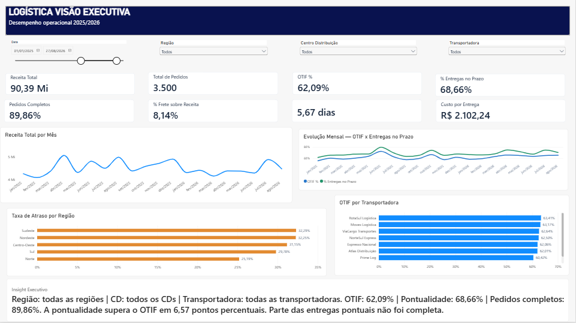
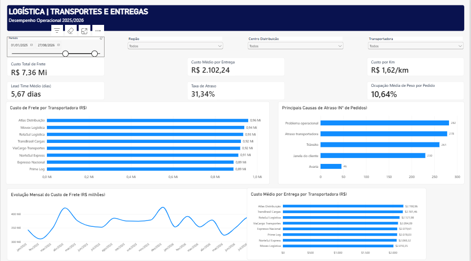
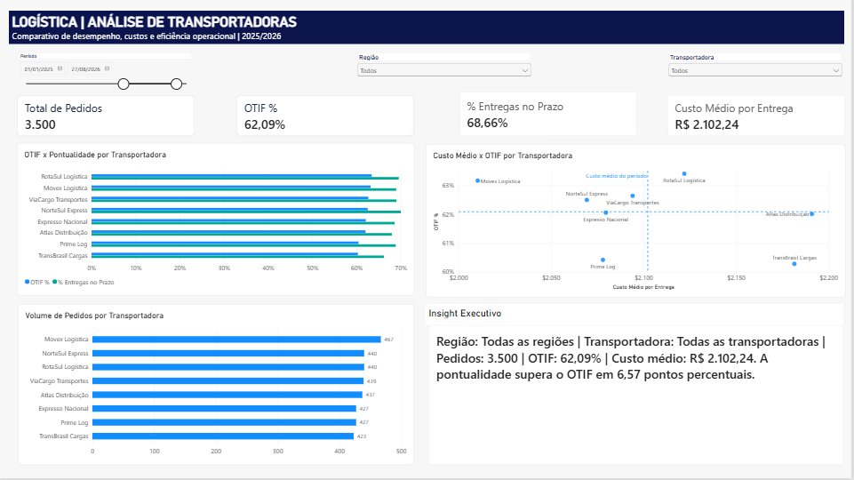

# 🚚 Dashboard de Logística | Power BI

## 📊 Sobre o projeto

Projeto de Business Intelligence desenvolvido em Power BI
para analisar custos logísticos, eficiência das entregas
e desempenho de transportadoras.

A análise utiliza uma base fictícia com 3.500 pedidos
e 8 transportadoras.

O objetivo é transformar dados operacionais em informações
que apoiem a análise e a tomada de decisão.

## 🎯 Objetivos

- Monitorar indicadores de desempenho logístico.
- Analisar custos de transporte.
- Identificar ocorrências associadas aos atrasos.
- Comparar o desempenho das transportadoras.
- Avaliar a pontualidade e a completude das entregas.
- Permitir análises por período, região e transportadora.

## 📈 Indicadores analisados

| Indicador | Resultado |
|---|---|
| Receita Total | R$ 90,39 milhões |
| Total de Pedidos | 3.500 |
| OTIF | 62,09% |
| Entregas no Prazo | 68,66% |
| Pedidos Completos | 89,86% |
| Custo Total de Frete | R$ 7,36 milhões |
| Custo Médio por Entrega | R$ 2.102,24 |
| Lead Time Médio | 5,67 dias |
| Taxa de Atraso | 31,34% |

## 🖥️ Estrutura do Dashboard

### 1. Visão Executiva

Apresenta os principais indicadores da operação,
a evolução da receita e o desempenho das entregas.

### 2. Transportes e Entregas

Permite analisar custos de frete, atrasos,
lead time e ocorrências operacionais.

### 3. Análise de Transportadoras

Compara as transportadoras considerando:
- OTIF;
- Pontualidade;
- Custo médio por entrega;
- Volume de pedidos.

## 💡 Principais Insights

- O OTIF geral foi de 62,09%.
- A pontualidade atingiu 68,66%.
- A diferença entre pontualidade e OTIF foi de
  6,57 pontos percentuais.
- A taxa de atraso registrada foi de 31,34%.
- As transportadoras apresentam diferenças
  de custos e desempenho que podem ser investigadas.

## 🛠️ Ferramentas e habilidades

- Power BI
- Power Query
- DAX
- Modelagem de dados
- Relacionamentos entre tabelas
- Criação de indicadores (KPIs)
- Visualização de dados
- Análise exploratória de dados
- Storytelling com dados

## 📌 Observação

Este projeto foi desenvolvido com dados fictícios
para fins de estudo, aprendizado e portfólio profissional.

## 👩‍💻 Autora

**Danila Oliveira Silva Moreno**

Projeto desenvolvido como parte da minha jornada
de desenvolvimento profissional em Análise de Dados
e Business Intelligence.

---

## 🖼️ Visualização do Dashboard

### 📊 Página 1 — Visão Executiva

### 🚚 Página 2 — Transportes e Entregas

### 📈 Página 3 — Análise de Transportadoras

---

## 📥 Como utilizar o projeto

1. Baixe os arquivos:
   - `Dashboard_Logistica_Analise_Operacional.pbix`
   - `Base_Logistica_Empresa_Medio_Porte.xlsx`

2. Abra o arquivo `.pbix` no Power BI Desktop.

3. Caso seja necessário atualizar os dados, altere o
   caminho da fonte Excel para o local onde você salvou
   a planilha no seu computador.

4. Atualize os dados no Power BI.

5. Explore as três páginas do dashboard utilizando
   os filtros de período, região, centro de distribuição
   e transportadora.

**Observação:** o arquivo Power BI foi desenvolvido
com uma fonte Excel local. Por isso, quem baixar o
projeto precisará ajustar o caminho da fonte para
atualizar os dados.
